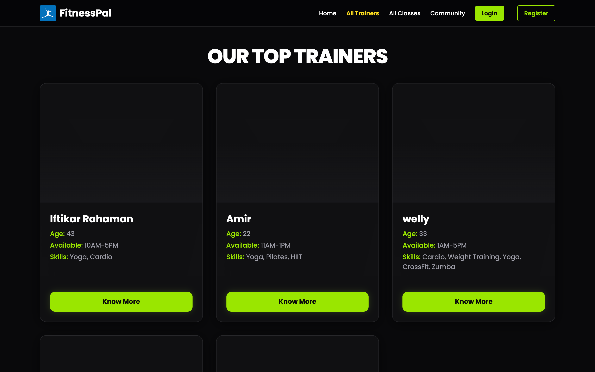
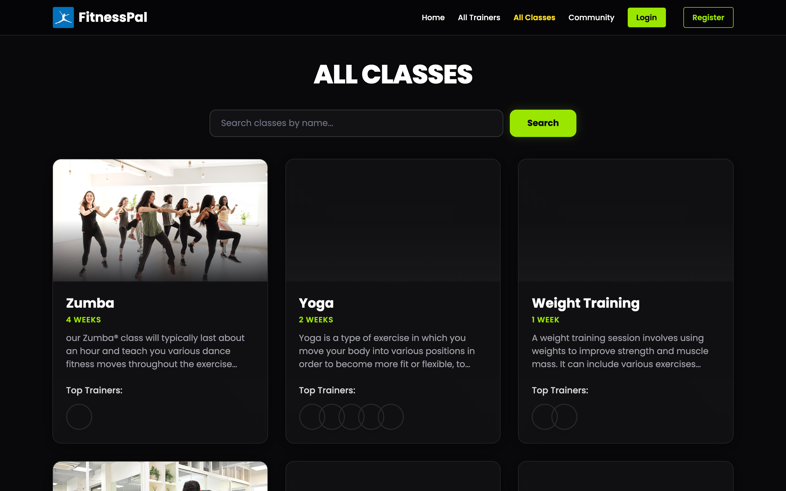
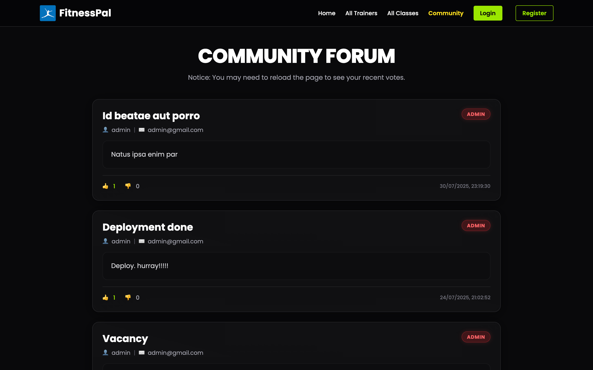

# Fitness Tracker

**Full-Stack MERN Fitness Coaching, Class Booking & Community Platform**


Fitness Tracker is a full-stack MERN application combining trainer discovery, class enrollment, Stripe booking checkout, a vote-enabled fitness community forum, and three role-scoped dashboards (**Member**, **Trainer**, and **Admin**).

- **Live Website:** [https://fitness-tracker-faf6f.web.app/](https://fitness-tracker-faf6f.web.app/)

---

## Screenshots

| Landing & Featured Classes | Trainer Directory |
| :---: | :---: |
|  |  |

| Classes Explorer | Community Forum |
| :---: | :---: |
|  |  |

---

## Core Features

- **Role-Based Dashboards (Admin / Trainer / Member)**: Firebase authentication paired with JWT-protected API routes and role-scoped views.
- **Stripe Trainer Booking Checkout**: Integrated Stripe Elements checkout (`@stripe/react-stripe-js`) for paid training slot reservations.
- **Trainer Application & Approval Workflow**: Members can apply to become trainers; Admins approve or reject applicants with structured feedback modals.
- **Trainer Slot Management**: Trainers create and delete availability slots and inspect upcoming member bookings.
- **Community Forum & Voting**: Upvote/downvote discussions with role badges (`Admin` / `Trainer`) and homepage community highlights.
- **Class Explorer & Analytics**: Top-6 featured classes sorted by booking count, backend case-insensitive class search, Recharts dashboard visuals, and TanStack Query / Axios fetching.

---

## Tech Stack

| Layer | Technology |
| :--- | :--- |
| **Frontend** | React 19, Vite 7, React Router 7, Tailwind CSS 4, Ant Design, Flowbite, Framer Motion, Three.js, Recharts, React Select, SweetAlert2 |
| **Payments** | Stripe (`@stripe/stripe-js`, `@stripe/react-stripe-js`, `stripe`) |
| **Backend API** | Node.js, Express 5.1, MongoDB Driver 6.17, JWT (`jsonwebtoken`), `bcryptjs`, CORS, `dotenv` |
| **Auth & Hosting** | Firebase Auth & Admin SDK, Firebase Hosting (`firebase.json`), Vercel (`vercel.json`) |

---

## Project Structure

```text
Fitness_Tracker_Client_Server/
├── fitness_tracker_client/              # React + Vite frontend
│   ├── public/
│   ├── src/
│   │   ├── assets/
│   │   ├── contexts/                    # Auth context & JWT state
│   │   ├── firebase/                    # Firebase config
│   │   ├── hooks/                       # Custom role & API hooks
│   │   ├── layouts/                     # Main & Dashboard layouts
│   │   ├── pages/                       # Public & role dashboard pages
│   │   ├── router/                      # Route guards & routing table
│   │   └── utils/
│   ├── firebase.json
│   └── package.json
├── Fitness_tracker_server/              # Express + MongoDB + Stripe server
│   ├── convertKey.js                    # Firebase service account encoder
│   ├── index.js                         # REST API & Stripe handlers
│   ├── vercel.json
│   └── package.json
└── docs/screenshots/
```

---

## Demo Admin Credentials

- **Email:** `admin@gmail.com`
- **Password:** `@Dmin123`

---

## Local Setup

### Prerequisites

- Node.js 18+
- MongoDB Atlas URI
- Firebase project & Stripe test API keys

### 1. Server Setup

```bash
git clone https://github.com/IFTI-KAR/Fitness_Tracker_Client_Server.git
cd Fitness_Tracker_Client_Server/Fitness_tracker_server
npm install
```

Create `Fitness_tracker_server/.env` with your MongoDB URI, `JWT_SECRET`, `STRIPE_SECRET_KEY`, and Firebase Admin credentials, then run:

```bash
node index.js
```

### 2. Client Setup

In a new terminal:

```bash
cd Fitness_Tracker_Client_Server/fitness_tracker_client
npm install
```

Create `fitness_tracker_client/.env` with your `VITE_*` Firebase keys, backend API URL, and `VITE_STRIPE_PK`, then start Vite:

```bash
npm run dev
```
